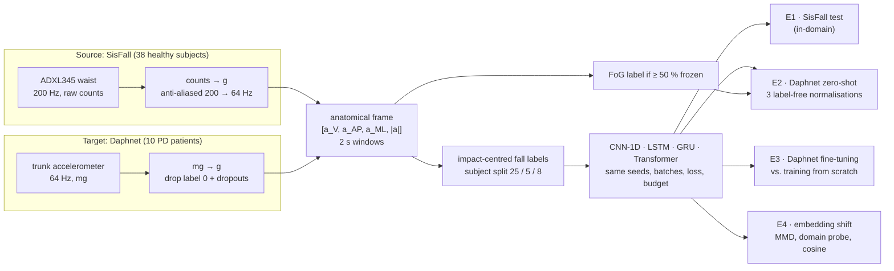
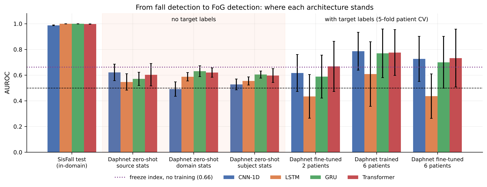

# From Simulated Falls to Freezing of Gait

[](https://doi.org/10.5281/zenodo.23464664)

**A controlled study of domain shift in wearable accelerometry: CNN-1D, LSTM, GRU and a patch Transformer trained on SisFall and transferred zero-shot to Parkinsonian freezing of gait (Daphnet).**

Paul Christopher Aimé · ENSA Marrakech, Cadi Ayyad University · supervised by Pr. Mustapha Ameur

[Paper (PDF)](paper/main.pdf) · [Poster (PDF)](paper/poster/poster.pdf) 

---

## Abstract

Fall detectors for wearables are trained on falls simulated by healthy volunteers, yet they are meant for people whose movement and whose falls look different. This project takes the most extreme version of that mismatch: four deep architectures trained on **SisFall** (38 healthy subjects) are applied, with no patient label, to **freezing of gait (FoG)** in **Daphnet** (10 people with Parkinson's disease). The comparison is controlled:

- the same sensor site in both domains, in a common anatomical frame;
- the same units and sampling rate;
- impact-centred fall labels;
- identical training conditions for every model.

In-domain, all four models are excellent: AUROC 0.988–0.999, with 0.7–1.5 false alarms per hour. Zero-shot, AUROC falls to 0.49–0.63. At their validated threshold the detectors stay silent on FoG (recall under 1%), and false alarms on Parkinsonian walking rise 15–18×. A training-free freeze index (AUROC 0.66) beats every network. The analysis of the embeddings shows that the gap is dominated by **concept shift**:

- label-free re-normalisation gives no consistent gain;
- healthy and Parkinsonian movement stay linearly separable in every representation;
- the learned "fall" direction is nearly orthogonal to the "freeze" direction;
- fine-tuning from fall weights is worse than training from scratch.

## Design choices

A transfer experiment between SisFall and Daphnet is easy to confound. Every shortcut below would change the outcome for reasons unrelated to Parkinson's disease, so each one is removed by construction:

| | Common shortcut | This repository |
|---|---|---|
| Fall labels | every window of a fall file | windows centred on the detected impact |
| Sensors compared | whatever channels each dataset offers | one waist sensor vs. the trunk sensor, same anatomical frame |
| Sampling rate | target upsampled to the source rate | SisFall downsampled to 64 Hz (anti-aliased) |
| Target windows | across concatenated recordings, sensor dropouts kept | inside contiguous valid segments, dropouts removed |
| Training | tuned separately for each model | identical seeds, batches, loss, optimiser and tuning budget |
| Threshold | fixed by hand | F2-optimal on source validation |
| Analysis | zero-shot score only | + normalisation ablation, target ceiling, fine-tuning, embedding-level shift |

## Pipeline



The Transformer tokenises each 2 s window into non-overlapping patches of all four channels (PatchTST-style), adds a `[CLS]` token and learned positions, and runs pre-norm encoder layers:

```
x ∈ R^{128×4} ──► split into 16 patches of 8 samples ──► Linear(32 → d) ──► [CLS] ⊕ tokens + pos
              ──► L × (LayerNorm → MHSA → LayerNorm → GELU-FFN) ──► LayerNorm([CLS]) ──► Linear → logit
```

## Results

All numbers are mean ± std over three seeds and come from `results/metrics/` (written by the notebooks).

**In-domain (8 unseen SisFall subjects) and zero-shot (all Daphnet recordings, independent domain normalisation):**

| Model | Params | SisFall AUROC | SisFall recall | False alarms / h | Daphnet AUROC | Daphnet FoG recall | Daphnet false alarms / h |
|---|---:|---:|---:|---:|---:|---:|---:|
| CNN-1D | 36k | 0.987 ± 0.003 | **0.980** | 1.5 | 0.491 ± 0.056 | 0.9% | 23.3 |
| LSTM (bi, 2×64) | 135k | **0.999** ± 0.000 | 0.977 | 0.8 | 0.587 ± 0.032 | 0.1% | 13.6 |
| GRU (bi, 2×32) | 26k | **0.999** ± 0.000 | 0.977 | **0.7** | **0.631** ± 0.042 | 0.0% | **11.8** |
| Patch Transformer | 70k | 0.998 ± 0.001 | 0.959 | 0.9 | 0.620 ± 0.036 | 0.0% | 17.1 |
| *Freeze index (no training)* | – | – | – | – | *0.663* | – | – |

Patient-level 95% bootstrap intervals for the Daphnet AUROC of the seed ensembles: CNN-1D [0.41, 0.55], LSTM [0.38, 0.71], GRU [0.46, 0.77], Transformer **[0.55, 0.73]** (the only one excluding chance).

**Why it fails:**

| | CNN-1D | LSTM | GRU | Transformer |
|---|---:|---:|---:|---:|
| Zero-shot AUROC, source / domain / subject normalisation | 0.62 / 0.49 / 0.53 | 0.55 / 0.59 / 0.55 | 0.57 / 0.63 / 0.60 | 0.60 / 0.62 / 0.60 |
| Domain-probe AUROC, healthy ADL vs PD walking (embedding) | 0.995 | 0.975 | 0.981 | 0.962 |
| cos(fall − ADL, FoG − walk) in the embedding (input space: 0.77) | 0.18 | 0.10 | −0.03 | 0.12 |
| Daphnet AUROC, trained from scratch on 6 patients (5-fold) | **0.786** | 0.608 | 0.769 | 0.776 |
| … fine-tuned from SisFall weights | 0.727 | 0.437 | 0.700 | 0.732 |

<p align="center"></p>

**Take-aways:**

1. In-domain accuracy says nothing about transfer, and source validation cannot rank models by transferability.
2. With matched sensors and impact-centred labels, the detectors are specific to impacts rather than to "abnormal movement": they stay silent on freezing.
3. The gap is a change of *event*, not only of population. Physics-based features, or event-agnostic self-supervised pre-training, are better starting points than fall labels.

## Repository layout

```
parkinson-domain-shift/
├── data/
│   ├── raw/archives/          SisFall_dataset.zip, Daphnet_dataset.zip (not versioned)
│   └── processed/             windows in g, metadata, scalers, PyTorch tensors (generated)
├── notebooks/                 01 → 07, executed with outputs (+ jupytext .py twins)
├── src/                       models, training loop, metrics, transforms, shared config
├── models/<arch>/seed<k>.pt   checkpoints: weights + config + scaler + threshold
├── results/
│   ├── figures/               all figures (PNG + PDF), English labels
│   ├── metrics/               every number in the paper, as CSV / JSON
│   ├── confusion_matrices/
│   └── logs/
├── paper/                     LaTeX sources, main.pdf, poster/poster.pdf
├── colab/RUN_ON_COLAB.ipynb   one-click GPU run on Google Colab
└── docs/research_plan.md
```

## Getting the data

Neither dataset is redistributed here.

* **SisFall** (Sucerquia et al., *Sensors* 2017). The original SISTEMIC download page is no longer online; request the archive from the authors or use an institutional copy. Expected file: `SisFall_dataset.zip` (238,324,928 bytes) containing `SisFall_dataset/SAxx|SExx/*.txt`.
* **Daphnet Freezing of Gait** (Bächlin et al., *IEEE TITB* 2010), UCI Machine Learning Repository, dataset 245. Any archive that contains `dataset_fog_release/dataset/S01R01.txt … S10R01.txt` works; the copy used here is 68,518,629 bytes.

Place both zips in `data/raw/archives/`. Notebook 01 extracts them and never modifies the raw files.

## Reproducing

```bash
pip install -r requirements.txt
cd notebooks
for nb in 01_data_preparation 02_exploratory_analysis 03_hyperparameter_search \
          04_training_and_zero_shot 05_target_adaptation 06_shift_analysis 07_paper_assets; do
    jupyter nbconvert --to notebook --execute --inplace --ExecutePreprocessor.timeout=-1 $nb.ipynb
done
cd ../paper && latexmk -pdf main.tex && cd poster && lualatex poster.tex && lualatex poster.tex
```

Notebooks 03 and 05 append results row by row and skip finished runs on restart; notebook 04 reloads existing checkpoints. On a free Colab T4 the whole pipeline (01–06) took about 40 minutes: upload the code zip and the two archives, open `colab/RUN_ON_COLAB.ipynb` and run all cells.

## Citation

```bibtex
@techreport{aime2026fall2fog,
  author      = {Aim{\'e}, Paul Christopher},
  title       = {From Simulated Falls to Freezing of Gait: A Controlled Study of Domain Shift in Wearable Accelerometry},
  institution = {{\'E}cole Nationale des Sciences Appliqu{\'e}es de Marrakech, Cadi Ayyad University},
  year        = {2026}
}
```

## Acknowledgements

This work grew out of a group project carried out with Rokhaya Gueye and Agrhib Azar, supervised by Pr. Mustapha Ameur. SisFall was collected by the SISTEMIC group (Universidad de Antioquia) and Daphnet by the DAPHNet consortium and the Tel Aviv Sourasky Medical Center.
